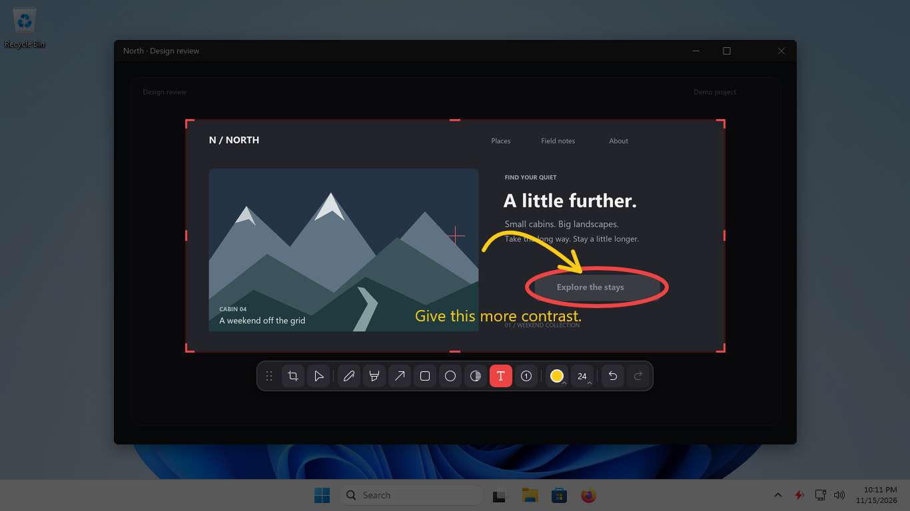

<div align="center">


# Flinch

**Screenshots, recordings and GIFs for Windows.**

[](https://github.com/Vulptik/flinch/actions/workflows/build.yml)
[](LICENSE)

<a href="https://apps.microsoft.com/detail/9MVHXWLW9N69"></a>&nbsp;
<a href="https://flinch.vulptik.dev/download"></a>



[Install](#install) · [Features](#features) · [Shortcuts](#shortcuts) · [Privacy](#privacy) · [Build from source](#build-from-source)

</div>

## Install

Flinch runs on Windows 10 version 2004 or later and Windows 11 (x64).

- **Microsoft Store:** installs and updates automatically.
- **Installer** from [flinch.vulptik.dev](https://flinch.vulptik.dev/download): installs
  for your account by default and adds Microsoft's Visual C++ runtime only if it's missing.
  Settings shows a link when a new version is out.

The installer isn't code-signed, so Windows SmartScreen may warn you the first time; choose
**More info → Run anyway**, or use the Store version.

## Features

- **Screenshots** of an area, the full screen or the active window, saved as PNG, JPG or WebP or
  copied to the clipboard
- **Capture and Edit** with pen, arrows, shapes, blur, text and numbered markers; drawings stay
  editable, with undo and redo
- **Video and GIF recording** with pause and resume and optional system audio
- **Copy Text** reads the text in a selected area, offline
- **Color Picker** copies a pixel's color as HEX
- **Magnifier** for pixel-accurate selections
- **Tray menu** with your last five captures
- Global shortcuts, filename and subfolder templates, launch at startup

## Shortcuts

| Action | Default |
| --- | --- |
| Area screenshot | <kbd>Ctrl</kbd> + <kbd>PrtSc</kbd> |
| Full-screen screenshot | <kbd>Shift</kbd> + <kbd>PrtSc</kbd> |
| Active-window screenshot | <kbd>Alt</kbd> + <kbd>PrtSc</kbd> |
| Capture and Edit, video, GIF, Copy Text, Color Picker | Unassigned; set them under **Settings → Hotkeys** |

> [!TIP]
> Hold <kbd>Alt</kbd> as you release an area selection to jump straight into edit mode, then press <kbd>Enter</kbd> to capture.

<details>
<summary><b>Editing shortcuts</b></summary>

<br>

- **Double-click** a pen stroke to edit its nodes; double-click its path to add one. Arrow nodes are directly editable.
- **Delete** removes the selected node; **Escape** cancels a drag first, then leaves node mode.
- **Shift** keeps proportions while resizing and snaps rotation to 15°.
- **M** toggles the Magnifier during any selection.

</details>

## Privacy

Your captures never leave your PC. Text recognition runs offline, and Flinch has no telemetry or
analytics. Its only network request is the optional update check in installer builds, which you can
turn off in Settings; Store builds never make it. Links in Settings open in your browser only
when you click them.

Settings are stored in `%APPDATA%\flinch\config.json` and logs in `%APPDATA%\flinch\logs`.

## Build from source

You need a stable Rust MSVC toolchain and the Visual Studio C++ build tools; everything runs
through Cargo.

```powershell
cargo xtask doctor      # check prerequisites
cargo run               # launch Flinch
cargo xtask check:quick # fast validation
cargo xtask test        # quiet test suite
```

Quiet checks never touch the desktop. Anything that captures the screen, opens windows or
registers hotkeys has an explicit `:desktop` command. To build the packages:

```powershell
cargo xtask installer:tools                       # once: fetch pinned WiX 7 tools
cargo xtask pack:installer                        # → artifacts/installer/working/build/
cargo xtask pack:msix --local-test --revision 1   # signed local-test MSIX
```

See the [architecture overview](docs/architecture.md) and [CONTRIBUTING.md](CONTRIBUTING.md) to
get started on a change. Set `RUST_LOG=flinch=debug` for verbose logging.

## How Flinch is made

Flinch is built with AI coding tools. I decide what Flinch does, direct the work and test each release myself; the tools write much of the code. The test suite, the coverage gate and the speed gate exist so every change has to prove itself, whoever or whatever wrote it.

## License

Flinch is free software under the [GNU General Public License v3.0 only](LICENSE). The installer
is under the MIT License because it links the WiX Burn engine; see [NOTICE.md](NOTICE.md).
Bundled third-party components keep their own licenses. The app uses Slint under the GPL-3.0; the
installer uses Slint under its Royalty-free license, with attribution on the website.

The Flinch name and logo are trademarks of Vulptik; forks must use their own. See the
[trademark policy](TRADEMARKS.md). Found a security issue? See [SECURITY.md](SECURITY.md).
